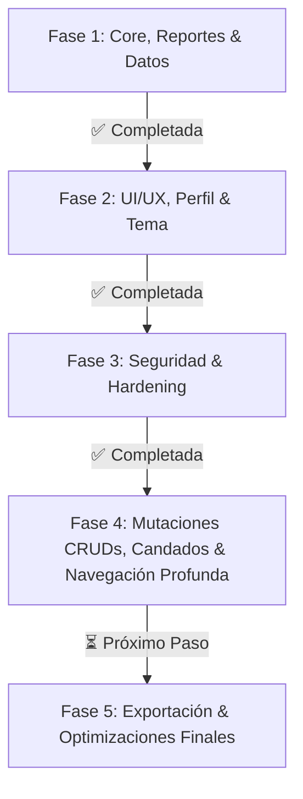

# Requerimientos — Proyecto Vino Nuevo

## Descripción General
Aplicación web de gestión y reportes para un servicio comunitario (ministerio "Vino Nuevo").  
**Stack:** Python Flask + MySQL (PyMySQL) + HTML/CSS/JS (Jinja2) + React SPA (TypeScript + Vite)  
**Cobertura y Calidad:** 274 pruebas automatizadas en backend (`unittest`) + 63 pruebas unitarias e integración en frontend (`vitest`), ejecutadas y pasando al 100%.

---

## 1. Estado General de Requerimientos

**Criterio de Evaluación:** Se considera **Implementado (✅)** lo que está conectado a una ruta, servicio, consulta o listener funcional con persistencia en BD y validado por pruebas automatizadas. Lo que cuenta con backend funcional pero le faltan mutaciones o frontend se cataloga como **Parcial (⚠️)**. Lo que no tiene desarrollo se cataloga como **Pendiente (❌)**.

| # | Requerimiento | Estado actual | Evidencia y Trabajo Pendiente |
|---|---|---|---|
| 1 | **INSERT y Guardado de Reportes en BD** | ✅ Implementado | `services/cdp_service.py:process_reporte()` y `db_queries.insertar_reporte()`. Formulario conectado en `POST /lider_cdp/generar_reporte`, con UUID(), invalidación de caché, soporte de ofrendas duales (USD/Bs), cálculo dinámico desacoplado (`generar_reporte.js`), idempotencia de envío (`form_guard.js`) y control transaccional con rollback. |
| 2 | **Edición y Eliminación de Reportes (Líder CDP)** | ✅ Implementado | Modales funcionales en `index.html` con endpoints `POST /lider_cdp/reporte/<id>/editar` y `POST /lider_cdp/reporte/<id>/eliminar`, control de permisos por CDP, validación anti-IDOR de `cdp_id` y confirmación. |
| 3 | **Script de Poblado y Test Data** | ✅ Implementado | `insert_test_data.py` con soporte para SSL en BD remota (Aiven/Cloud), dotenv, generación de UUIDs, hashes Werkzeug y 8 semanas de reportes históricos e idempotencia. Script de saneamiento `scripts/cleanup_duplicate_reports.py`. |
| 4 | **Dashboard con Datos Reales, Períodos Dinámicos (Semana/Mes/Año) y Gráficos Interactivos** | ✅ Cumplido | `dashboard_service.py`, `db_queries.py` y `mock_data.py` con métricas jerárquicas (General, Red, CDP) y selector interactivo de períodos (**Semana / Mes / Año**). Adaptación dinámica de títulos con nombre de período/mes específico (ej: "Septiembre 2026"), interpolación continua de meses en período anual (incluyendo meses intermedios con asistencia 0 entre el primer y último mes con reportes), navegación por clic desde las barras del año hacia el mes respectivo, sincronización completa de KPIs (fruto y visitas), tooltips con rangos de fechas (`rango_fecha`), scroll horizontal adaptativo para series extensas (> 7 puntos), sincronización automática con la semana activa del último reporte recibido (`MAX(fecha)`) en Vista General ante ausencias en los últimos 7 días calendario para evitar pantallas en cero con BD conectada, prevención de caché en métricas vacías y optimización de consultas de alertas y ranking compatibles con `ONLY_FULL_GROUP_BY` (`tests/test_dashboard_metrics.py`). Paridad estructural 1 a 1 y visual en React SPA con Jinja (`dashboard_admin.html`): distribución estricta en 2 columnas (`.main-column` y `.sidebar-column`), Donut completo y Fruto en sidebar en General, Actividad Reciente y Alertas/Cumplimiento/Líderes en Red, Ficha superior con WhatsApp, tabla de Historial, Dinámica, Notas y mini gráfico de 4 barras en CDP, estado vacío "Sin Casas de Paz Asignadas" sin fuga entre redes, y visualización condicionada de datos ("Sin datos" cuando `total_casas === 0`). Validado por 7 pruebas de integración en `tests/test_api_dashboard_datos.py` y 18 pruebas en frontend con Vitest. |
| 5 | **Filtros de Reportes (Admin & Supervisor)** | ✅ Implementado | Búsqueda por texto libre, red, Casa de Paz y rango de fechas (`fecha_desde`, `fecha_hasta`) en vistas de administración y supervisión regional. |
| 6 | **Paginación Real Server-Side** | ✅ Implementado | Paginación con ventana deslizante (±2 páginas) y puntos suspensivos en **Reportes**, **Usuarios**, **Líderes** y en el historial del **Dashboard de Líder CDP**. |
| 7 | **Vistas de Supervisor Aisladas por Red y Protección de API** | ✅ Implementado | Dashboard, Estructura, Reportes y Directorio de Líderes con filtrado y aislamiento estricto por la red asignada al supervisor. Endpoint `/api/dashboard/datos` con validación estricta que impide consultas fuera de la red del supervisor (403 Forbidden / Anti-IDOR). |
| 8 | **Vista de Detalle de Casa de Paz y Blindaje de Fallbacks** | ✅ Implementado | Rutas `/admin/casa_de_paz/<id>` y `/supervisor/casa_de_paz/<id>` con `detalles_cdp.html`. Muestra cuenta de usuario del sistema (`@username`), botón de gestión directa de credenciales, teléfono propio de la casa con llamadas y WhatsApp directo, equipo ministerial y badge dinámico de cumplimiento semanal (7 días). Blindaje de consultas para evitar filtración de datos mock en producción. |
| 9 | **Navegación Profunda y Filtros URL en Estructura** | ✅ Implementado | Soporte de parámetros URL (`red_id`, `cdp_id`, `filtro`, `q`) en `/admin/estructura` y `/supervisor/estructura`. Selección automática de red, scroll suave y resaltado visual enfocado en la Casa de Paz seleccionada desde el Dashboard u otras vistas (`tests/test_estructura_url_filters.py`). |
| 10 | **Módulo de Perfil y Credenciales** | ✅ Implementado | Perfil unificado en Admin, Supervisor y Líder CDP con cambio de nombre de usuario, cambio de contraseña con verificación de clave actual, indicador de fortaleza y hash Werkzeug. Cobertura en `tests/test_perfil.py`. |
| 11 | **Conectividad Resiliente con Circuit Breaker, Scoped Connection & Pool Persistente** | ✅ Implementado | `database.py` con `_RequestScopedConnection` y pool persistente de conexiones reutilizables (`queue.LifoQueue`), circuit breaker con reintentos configurables, drenado de sockets en reset y limpieza en `teardown_appcontext`. Fallback transparente a modo demo cuando la base de datos externa no está disponible y `MOCK_MODE=True`. Soporte de bypass en testing con `DISABLE_CACHE`. |
| 12 | **Modo Oscuro Global** | ✅ Implementado | Variable `data-theme="dark"`, persistencia en `localStorage`, inicializador centralizado anti-FOUC (`theme_init.js`) y selectores de tema accesibles en login y perfil. |
| 13 | **Flash Messages y Notificaciones Toast** | ✅ Implementado | Script desacoplado `static/scripts/toast.js` con auto-dismiss (5s), animación de desvanecimiento, categorías semánticas (`success`, `danger`, `warning`, `info`) e iconos contextuales en `admin_layout.html` y `admin_form_layout.html`. |
| 14 | **Páginas de Error Personalizadas** | ✅ Implementado | Plantillas de error 400, 403, 404, 429 (Rate Limit excedido) y 500 (Error interno) estilizadas bajo el design system, con soporte de modo oscuro y botones de retorno contextual. |
| 15 | **CRUD de Usuarios Completo y Candados de Eliminación** | ✅ Implementado | Rutas `POST /admin/usuario/crear`, `POST /admin/usuario/<id>/editar`, `POST /admin/usuario/<id>/toggle_estado` y `POST /admin/usuario/<id>/eliminar`. Validación backend estricta, hashes Werkzeug, modales de confirmación (`usuarios.js`, `form_usuario.js`) y **Candados de Eliminación Segura** (`tests/test_usuario_delete_guards.py`): impide eliminar usuarios que supervisen redes o lideren CDPs activas. |
| 16 | **CRUD de Casas de Paz (Mutaciones POST y Baja Defensiva)** | ✅ Implementado | Rutas `POST /admin/casa_de_paz/crear`, `POST /admin/casa_de_paz/<id>/editar`, `POST /admin/casa_de_paz/<id>/toggle_estado` y `POST /admin/casa_de_paz/<id>/eliminar` conectadas (`tests/test_cdp_crud.py`). Creación dual (usuario nuevo o existente), edición completa y baja defensiva (bloquea si tiene líderes, aplica soft-delete si tiene reportes, o eliminación física limpia si no tiene dependencias). |
| 17 | **CRUD de Redes (Mutaciones POST y Estado)** | ✅ Implementado | Rutas `POST /admin/red/crear`, `/admin/red/<id>/editar`, `/admin/red/<id>/toggle_estado` y `/admin/red/<id>/eliminar` conectadas y funcionales (`tests/test_red_toggle_estado.py`). Asignación/desvinculación de supervisor, alternancia activa/pausada con insignias dinámicas, invalidación de caché y eliminación protegida sin huérfanos. |
| 18 | **CRUD de Líderes Completo y Candados de Eliminación** | ✅ Implementado | Rutas `POST /admin/lider/crear`, `POST /admin/lider/<id>/editar`, `POST /admin/lider/<id>/toggle_estado` y `POST /admin/lider/<id>/eliminar`. Asignación y cambio de Casa de Paz, validación de teléfonos y **Candados de Eliminación Segura** (`tests/test_lider_delete_guards.py`): bloquea eliminación permanente si el líder tiene reportes históricos enviados para preservar la auditoría ministerial. |
| 19 | **Gestión Jerárquica de Estado y Cascada de Reactivación** | ✅ Implementado | Lógica de estado interconectada (`tests/test_reactivacion_estado.py` y `test_supervisor_and_cascading.py`): pausar una red o CDP propaga el estado de inactividad correspondiente y reactivar valida la disponibilidad y jerarquía superior. |
| 20 | **Seguridad en Login con Google reCAPTCHA v2 / v3 y Anti-Open Redirect** | ✅ Implementado | Integración de reCAPTCHA en `routes/auth_routes.py`, `config.py` y `static/scripts/login.js`. Sanitización estricta de redirecciones posteriores al login con `get_safe_redirect_url()` para prevenir vulnerabilidades de Open Redirect (`tests/test_security_remediations.py`). |
| 21 | **Monitoreo de Cumplimiento Semanal de Reportes (7 días)** | ✅ Implementado | `check_cdp_reporte_7d()` y `get_casas_sin_reporte_7d()`. Banner interactivo en Estructura con contador dinámico por red seleccionada, botón de filtro rápido ("Ver pendientes" / "Ver todas"), badges de alerta y modales informativos. |
| 22 | **Idempotencia, Accesibilidad de Formularios y Retención de Datos** | ✅ Implementado | `static/scripts/form_guard.js` implementado en todos los layouts: prevención de doble envío (`test_form_idempotency.py`), toggle accesible de contraseñas por teclado (`Enter`/`Espacio`) con atributos ARIA en formularios de Usuario y CDP (`form_cdp.html`, `form_usuario.html`), y retención de valores (`form_data`) con fecha por defecto ante fallos de validación en reportes (`generar_reporte.html`). |
| 23 | **Endurecimiento de Configuración de Producción (Fail-Fast)** | ✅ Implementado | `ProductionConfig.validate_production_environment()` en `config.py`: aborta el arranque si faltan variables críticas de BD, si `SECRET_KEY` es la default, o si `DEBUG=True` / `MOCK_MODE=True` en producción (`tests/test_production_config.py`). |
| 24 | **Modularización de Scripts JS y Desacoplamiento CSP** | ✅ Implementado | Extracción de scripts inline a módulos externos en `static/scripts/`: `theme_init.js`, `toast.js`, `login.js`, `generar_reporte.js`, `dashboard.js`, `form_guard.js`, `admin/form_cdp.js`, `admin/form_redes.js`, `admin/form_usuario.js` y `admin/lider.js`. |
| 25 | **Búsqueda Client-Side en Tiempo Real** | ⚠️ Parcial | **Completado en la vista de Estructura** (`static/scripts/estructura.js`): Búsqueda instantánea en vivo por código, líder, anfitrión y zona en `#casasSearchInput` sin recarga. <br>**Falta:** Extender el filtrado instantáneo en vivo (live search client-side) a las tablas de Usuarios y Líderes. |
| 26 | **Integración de Contacto por WhatsApp** | ⚠️ Parcial | Enlaces `wa.me` generados con compatibilidad en detalles de CDP, directorio de líderes y tarjetas de estructura. <br>**Falta:** Normalización estricta de códigos telefónicos internacionales (E.164) en todos los formularios de edición restantes. |
| 27 | **Exportación a PDF y Excel** | 🔄 En Progreso | Implementada exportación oficial a PDF de la **Ficha Técnica de Casa de Paz** (`detalles_cdp.html`, `detalles_cdp.js`) con diseño institucional imprimible, resumen de KPIs, desglose histórico de reuniones y equipo ministerial. <br>**Falta:** Implementar endpoints con descarga física en PDF (reportes consolidados con resumen de asistencia y ofrendas) y Excel (`.xlsx` o `.csv`) para reportes, usuarios, líderes y CDPs con filtros aplicados. |

---

## 2. Diagnóstico de Seguridad y Hardening

### 2.1 Estado de Controles de Seguridad

| # | Área de Seguridad | Estado | Nivel de Riesgo | Detalle Técnico |
|---|---|---|---|---|
| 1 | **Protección CSRF** | ✅ **Protegido** | **Bajo** | `Flask-WTF` activo con `CSRFProtect(app)` y tokens `{{ csrf_token() }}` inyectados en todos los formularios, modales POST y llamadas dinámicas. |
| 2 | **Rate Limiting en Autenticación** | ✅ **Protegido** | **Bajo** | `Flask-Limiter` activo limitando intentos en `POST /iniciar_sesion` (5 intentos por minuto) y límites globales anti-DoS, con plantilla de error personalizada `429.html`. |
| 3 | **Google reCAPTCHA en Login** | ✅ **Protegido** | **Bajo** | Verificación anti-bot con Google reCAPTCHA v2 / v3 en login (`RECAPTCHA_SITE_KEY`, `RECAPTCHA_SECRET_KEY`) con verificación server-side. |
| 4 | **Prevención de Open Redirect** | ✅ **Protegido** | **Bajo** | Sanitización de parámetro `next` mediante `utils/auth.py:get_safe_redirect_url()`, restringiendo destinos exclusivamente al mismo host. |
| 5 | **Protección Anti-IDOR y Aislamiento Territorial** | ✅ **Protegido** | **Bajo** | Rutas de supervisor (`/supervisor/...`) y API (`/api/dashboard/datos`) bloquean con `403 Forbidden` el acceso a redes o CDPs fuera de su territorio asignado. |
| 6 | **Cabeceras de Seguridad HTTP** | ✅ **Protegido** | **Bajo** | Inyección global en `after_request`: `X-Frame-Options: SAMEORIGIN`, `X-Content-Type-Options: nosniff`, `Content-Security-Policy` (CSP compatible con fonts y recaptcha), `Referrer-Policy` y `Permissions-Policy`. |
| 7 | **Hardening de Cookies de Sesión** | ✅ **Protegido** | **Bajo** | `SESSION_COOKIE_HTTPONLY=True`, `SESSION_COOKIE_SAMESITE='Lax'`, `SESSION_COOKIE_SECURE` y `PERMANENT_SESSION_LIFETIME=timedelta(hours=2)`. |
| 8 | **Validación y Sanitización Server-Side** | ✅ **Protegido** | **Bajo** | Módulo centralizado `utils/validators.py`: validación de tipos, rangos numéricos, coherencia horaria, teléfonos con formato E.164 y sanitización XSS (`markupsafe.escape`). |
| 9 | **Política de Complejidad de Contraseñas** | ✅ **Protegido** | **Bajo** | `validate_password_strength` exige mínimo 8 caracteres, al menos una mayúscula, una minúscula y un número en creación/edición de usuarios y CDPs. |
| 10 | **Gestión de Sesión en Logout & Fixation** | ✅ **Protegido** | **Bajo** | `session.clear()` en logout y regeneración/limpieza previa de sesión en login para neutralizar fijación de sesión. |
| 11 | **Hasheo de Contraseñas** | ✅ **Protegido** | **Bajo** | Implementado con Werkzeug `generate_password_hash` (`pbkdf2:sha256`), verificación segura y migración automática transparente de claves legacy. |
| 12 | **Inyección SQL** | ✅ **Protegido** | **Bajo** | Todas las consultas en `db_queries.py` y servicios utilizan consultas parametrizadas `%s` con tuplas. |
| 13 | **Control de Acceso Basado en Roles (RBAC)** | ✅ **Protegido** | **Bajo** | Decoradores `@login_required`, `@role_required("admin", "supervisor", "lider_cdp")` y validación de pertenencia territorial activa en vistas y API. |
| 14 | **Validación Fail-Fast en Producción** | ✅ **Protegido** | **Bajo** | Validación automática al iniciar la app en entorno productivo; impide despliegues con configuraciones inseguras. |
| 15 | **Desacoplamiento de Scripts JS (CSP Compliance)** | ✅ **Protegido** | **Bajo** | Eliminación de scripts JavaScript inline en layouts y templates, reduciendo la superficie de ataque XSS y habilitando directivas CSP estrictas sin `unsafe-inline`. |
| 16 | **Manejo Centralizado de Errores HTTP** | ✅ **Protegido** | **Bajo** | Handlers dedicados en `app.py` para códigos 400, 403, 404, 429 y 500, evitando divulgación de trazas de error (`stack traces`) al cliente. |

---

## 3. Estado de la Base de Datos (`serv_comunitario`)

El esquema relacional activo y verificado en MySQL:

```sql
-- Tabla: usuario
CREATE TABLE `usuario` (
  `id` char(36) NOT NULL DEFAULT uuid(),
  `username` varchar(30) NOT NULL,
  `password` varchar(255) NOT NULL,
  `tipo_usuario` enum('admin','supervisor','lider_cdp') NOT NULL,
  `is_active` tinyint(1) NOT NULL DEFAULT 1,
  `nombre` varchar(30) NOT NULL,
  `apellido` varchar(30) NOT NULL,
  PRIMARY KEY (`id`),
  UNIQUE KEY `username` (`username`)
) ENGINE=InnoDB DEFAULT CHARSET=utf8mb4 COLLATE=utf8mb4_general_ci;

-- Tabla: red
CREATE TABLE `red` (
  `id` int(11) NOT NULL AUTO_INCREMENT,
  `nombre` varchar(50) NOT NULL,
  `is_active` tinyint(1) NOT NULL DEFAULT 1,
  `supervisor_id` char(36) DEFAULT NULL,
  PRIMARY KEY (`id`),
  UNIQUE KEY `uq_red_supervisor` (`supervisor_id`),
  CONSTRAINT `fk_red_supervisor` FOREIGN KEY (`supervisor_id`) REFERENCES `usuario` (`id`) ON DELETE SET NULL ON UPDATE CASCADE
) ENGINE=InnoDB DEFAULT CHARSET=utf8mb4 COLLATE=utf8mb4_general_ci;

-- Tabla: cdp (Casa de Paz)
CREATE TABLE `cdp` (
  `id` int(11) NOT NULL AUTO_INCREMENT,
  `codigo` varchar(30) NOT NULL,
  `anfitrion` varchar(30) NOT NULL,
  `telefono` varchar(15) DEFAULT NULL,
  `direccion` varchar(100) NOT NULL,
  `is_active` tinyint(1) NOT NULL DEFAULT 1,
  `red_id` int(11) NOT NULL,
  `usuario_id` char(36) DEFAULT NULL,
  PRIMARY KEY (`id`),
  UNIQUE KEY `codigo` (`codigo`),
  UNIQUE KEY `usuario_id` (`usuario_id`),
  KEY `fk_cdp_red` (`red_id`),
  CONSTRAINT `fk_cdp_red` FOREIGN KEY (`red_id`) REFERENCES `red` (`id`) ON UPDATE CASCADE,
  CONSTRAINT `fk_cdp_usuario` FOREIGN KEY (`usuario_id`) REFERENCES `usuario` (`id`) ON DELETE SET NULL ON UPDATE CASCADE
) ENGINE=InnoDB DEFAULT CHARSET=utf8mb4 COLLATE=utf8mb4_general_ci;

-- Tabla: lider
CREATE TABLE `lider` (
  `id` int(11) NOT NULL AUTO_INCREMENT,
  `nombre` varchar(30) NOT NULL,
  `apellido` varchar(30) NOT NULL,
  `rol` enum('Lider','Sublider') NOT NULL,
  `telefono` varchar(15) DEFAULT NULL,
  `is_active` tinyint(1) NOT NULL DEFAULT 1,
  `cdp_id` int(11) NOT NULL,
  PRIMARY KEY (`id`),
  KEY `fk_lider_cdp` (`cdp_id`),
  CONSTRAINT `fk_lider_cdp` FOREIGN KEY (`cdp_id`) REFERENCES `cdp` (`id`) ON DELETE CASCADE ON UPDATE CASCADE
) ENGINE=InnoDB DEFAULT CHARSET=utf8mb4 COLLATE=utf8mb4_general_ci;

-- Tabla: reporte
CREATE TABLE `reporte` (
  `id` char(36) NOT NULL DEFAULT uuid(),
  `nro_niños` int(11) NOT NULL DEFAULT 0,
  `nro_regulares` int(11) NOT NULL DEFAULT 0,
  `nro_visitas` int(11) NOT NULL DEFAULT 0,
  `nro_comprometidos` int(11) NOT NULL DEFAULT 0,
  `reconciliaciones` int(11) NOT NULL DEFAULT 0,
  `confesiones` int(11) NOT NULL DEFAULT 0,
  `cesta_amor` tinyint(1) DEFAULT 0,
  `fecha` date DEFAULT curdate(),
  `hr_inicio` time NOT NULL,
  `hr_fin` time NOT NULL,
  `tema` varchar(100) NOT NULL,
  `observaciones` text DEFAULT NULL,
  `ofrendas_usd` decimal(10,2) NOT NULL DEFAULT 0.00,
  `ofrendas_bs` decimal(10,2) NOT NULL DEFAULT 0.00,
  `cdp_id` int(11) NOT NULL,
  `enviado_por_lider_id` int(11) DEFAULT NULL,
  PRIMARY KEY (`id`),
  UNIQUE KEY `uq_cdp_fecha` (`cdp_id`, `fecha`),
  KEY `fk_reporte_cdp` (`cdp_id`),
  KEY `fk_reporte_lider` (`enviado_por_lider_id`),
  CONSTRAINT `fk_reporte_cdp` FOREIGN KEY (`cdp_id`) REFERENCES `cdp` (`id`) ON DELETE RESTRICT ON UPDATE CASCADE,
  CONSTRAINT `fk_reporte_lider` FOREIGN KEY (`enviado_por_lider_id`) REFERENCES `lider` (`id`) ON DELETE SET NULL ON UPDATE CASCADE
) ENGINE=InnoDB DEFAULT CHARSET=utf8mb4 COLLATE=utf8mb4_general_ci;
```

---

## 4. Priorización y Roadmap de Desarrollo



### ✅ Fase 1 — Núcleo, Reportes y Datos (Completada)
- [x] Conexión centralizada a base de datos con Circuit Breaker, soporte SSL y reutilización por contexto de petición (`_RequestScopedConnection`).
- [x] Conexión completa de la planilla de reportes (`POST /lider_cdp/generar_reporte`) con persistencia en MySQL y soporte de ofrendas duales USD/Bs.
- [x] Gestión de reportes para Líder CDP: listado, modales de edición (`/reporte/<id>/editar`) y eliminación (`/reporte/<id>/eliminar`).
- [x] Script `insert_test_data.py` automatizado con hashes Werkzeug, soporte `.env` y SSL.
- [x] Dashboard dinámico multi-nivel con métricas jerárquicas, tarjetas interactivas y caché con invalidación.
- [x] Directorios de lectura de Usuarios, Líderes y Reportes con filtros combinados y paginación con ventana deslizante.
- [x] Vista detallada de Casa de Paz (`/admin/casa_de_paz/<id>` y `/supervisor/casa_de_paz/<id>`).

### ✅ Fase 2 — UI/UX, Perfil y Tema Oscuro (Completada)
- [x] Autenticación rediseñada con toggle de visibilidad de contraseña y selector de tema.
- [x] Módulo de Perfil para todos los roles con actualización de usuario y cambio de contraseña con validación de clave actual.
- [x] Modo oscuro global mediante CSS variables (`data-theme="dark"`), persistencia y prevención anti-FOUC (`theme_init.js`).
- [x] Toasts y notificaciones contextuales integradas en layouts base con auto-dismiss (`toast.js`).
- [x] Accesibilidad y diseño responsivo optimizado (móviles, tablets y desktop).
- [x] Páginas de error 400, 403, 404, 429 y 500 estilizadas e integradas al sistema visual.

### ✅ Fase 3 — Seguridad y Hardening (Completada)
- [x] **Protección CSRF**: Integración global de `Flask-WTF` con `CSRFProtect(app)` y tokens `{{ csrf_token() }}` en todos los formularios y modales.
- [x] **Rate Limiting**: `Flask-Limiter` activo en login (5 intentos por minuto) y límites globales anti-abuso.
- [x] **Google reCAPTCHA**: Protección anti-bot en login con validación server-side.
- [x] **Protección de API y Anti-IDOR**: `@login_required` y `@role_required` en `/api/dashboard/datos` con aislamiento de red.
- [x] **Prevención de Open Redirect**: Sanitización de parámetro `next` en login (`get_safe_redirect_url()`).
- [x] **Cabeceras de Seguridad HTTP**: CSP, HSTS, `X-Frame-Options: SAMEORIGIN`, `X-Content-Type-Options: nosniff` y `Referrer-Policy`.
- [x] **Hardening de Cookies y Sesiones**: `SESSION_COOKIE_HTTPONLY`, `SESSION_COOKIE_SAMESITE='Lax'`, timeout de sesión y `session.clear()` en logout.
- [x] **Endurecimiento de Producción**: Validación fail-fast en `ProductionConfig` (`validate_production_environment()`).
- [x] **Desacoplamiento CSP**: Eliminación de scripts JS inline en todos los templates.

### ✅ Fase 4 — Mutaciones CRUDs, Candados de Integridad e Idempotencia (Completada)
- [x] **CRUD Completo de Usuarios**: Creación, edición, alternancia de `is_active` y eliminación segura con candados (`test_usuario_delete_guards.py`).
- [x] **CRUD Completo de Casas de Paz**: Creación dual, edición, alternancia activa/pausada y baja defensiva (`test_cdp_crud.py`).
- [x] **CRUD Completo de Redes**: Creación, edición, alternancia activa/pausada y asignación de supervisor (`test_red_toggle_estado.py`).
- [x] **CRUD Completo de Líderes**: Creación, edición, alternancia de estado y eliminación protegida por historial (`test_lider_delete_guards.py`).
- [x] **Gestión Jerárquica de Estado**: Propagación y cascada de activación/pausa entre Redes, CDPs y Líderes (`test_reactivacion_estado.py`).
- [x] **Idempotencia de Formularios**: `form_guard.js` previniendo envíos dobles o repetidos en todos los formularios (`test_form_idempotency.py`).
- [x] **Navegación Profunda en Estructura**: Selección de red por URL, scroll y enfoque a la Casa de Paz seleccionada desde el Dashboard (`test_estructura_url_filters.py`).
- [x] **Monitoreo de Cumplimiento Semanal**: Detección de casas sin reporte en los últimos 7 días con badges y filtros en Estructura.
- [x] **Optimización del Dashboard y Selector Dinámico de Período**: Métricas semanales, mensuales y anuales con toggle dinámico (`semana`, `mes`, `anio`), ranking interactivo de redes, tooltips accesibles con `rango_fecha`, scroll horizontal adaptativo y caché multi-período (`test_dashboard_metrics.py`).
- [x] **Pool Persistente de Conexiones MySQL**: Reutilización segura de conexiones vivas (`LifoQueue`) en `database.py` para mitigar latencia de red SSL/TCP y drenado automático en reset del circuit breaker.
- [x] **Accesibilidad en Formularios y Retención de Datos**: Alternancia de contraseñas por teclado (Enter/Espacio) con atributos ARIA y preservación de campos (`form_data`) con fecha por defecto en la generación de reportes.

### ⏳ Fase 5 — Exportación y Optimizaciones Finales (En Curso)
- [x] **Exportación a PDF de Ficha Técnica de Casas de Paz**:
  - Generación de documento oficial imprimible/PDF (`detalles_cdp.js`, `detalles_cdp.html`) con membrete institucional, datos de anfitrión, supervisor, KPIs, integrantes y auditoría ministerial.
- [ ] **Generación de Reportes PDF/Excel Consolidados**:
  - Exportación de reportes filtrados a PDF con resumen de asistencia y ofrendas.
  - Exportación de listados de usuarios, líderes y Casas de Paz a Excel (`.xlsx` o `.csv`).
- [ ] **Búsqueda Instantánea Client-Side (Live Search)**:
  - Extender el buscador instantáneo en vivo sin recargar página (como en Estructura) a las tablas de Usuarios y Líderes.
- [ ] **Normalización Telefónica WhatsApp**:
  - Validar y formatear prefijo de país internacional (E.164) en todos los formularios para enlaces directos `wa.me`.
- [ ] **Despliegue y Verificación en Servidor de Producción**:
  - Verificación final de arranque con `ProductionConfig` y ejecución en servidor de despliegue.


### ✅ Fase 6 — Arquitectura Modular y Encapsulamiento del Backend (Completada)
- [x] **Encapsulamiento del Backend en `backend/`**: Aislamiento formal del código operativo del servidor Flask (`backend/`), plantillas Jinja2, archivos estáticos y suite de pruebas (`backend/tests/`), separando completamente el backend del proyecto React SPA (`frontend/`).
- [x] **Modularización de la API REST (`backend/routes/api/`)**: Descomposición del monolito `api_routes.py` en submódulos especializados por dominio (`auth_api.py`, `reportes_api.py`, `estructura_api.py`, `dashboard_api.py`, `system_api.py`) con contratos JSON estandarizados y exención centralizada de CSRF.
- [x] **Segregación del Repositorio de Consultas SQL (`backend/services/queries/`)**: Descomposición modular de consultas SQL por dominio (`reportes_queries.py`, `estructura_queries.py`, `lideres_queries.py`, `usuarios_queries.py`, `metricas_queries.py`, `helpers.py`), con fachada de compatibilidad transparente en `backend/db_queries.py`.
- [x] **Configuración de Despliegue en Render**: Actualización de `render.yaml` con `startCommand: gunicorn --chdir backend app:app`.
- [x] **Verificación Integral y 0 Regresiones**: 257 pruebas automatizadas ejecutadas y aprobadas exitosamente (`unittest`).

### ✅ Fase 7 — Single Page Application (SPA) en React y Paridad Visual/Funcional (En Curso / Recreación Fiel 1 a 1)
- [x] **Scaffold y Tooling (`frontend/`)**: Vite + React + TypeScript, Tailwind CSS, PostCSS, TanStack Query y React Router. Estandarización a gestor de paquetes **`pnpm`** (`pnpm-lock.yaml`), configuración `save-exact=true` en `.npmrc` y uso estricto de versiones exactas fijas sin rangos dinámicos (`^` / `~`).
- [x] **Sistema de Iconografía SVG Nativo (`Icon.tsx` & `iconsData.ts`)**: 114 trazados vectoriales oficiales de Google Material Symbols Outlined (`viewBox="0 -960 960 960"`) con tipado estricto `IconName`, herencia de color nativa (`fill="currentColor"`), soporte ARIA y cero peticiones de red externa o retrasos de renderizado.
- [x] **Recreación Fiel 1 a 1 de Inicio de Sesión (`LoginPage.tsx` & `login.css`) con reCAPTCHA v3, Rate Limiting y Dev Banner (`paridad-login-captcha-validaciones`)**:
  - Paridad visual y funcional 100% idéntica a `login.html` y `login.js` con imagotipo oficial `logo3.webp`, textura de fondo con opacidad `fondo.webp`, botón flotante selector de tema (`dark_mode`/`light_mode`), campos con `<Icon name="person" />`, `<Icon name="lock" />`, alternancia accesible de contraseña (`visibility`/`visibility_off`), alerta interactiva y encapsulamiento defensivo bajo `.login-page-wrapper`.
  - Integración reactiva de Google reCAPTCHA v3 con carga dinámica de script, endpoint de configuración pública `GET /api/auth/config`, captura de token con timeout defensivo de 4 segundos y detección amigable de bloqueadores de anuncios (adblockers).
  - Blindaje server-side en el endpoint REST `POST /api/auth/login` aplicando el decorador `@limiter.limit("5 per minute", methods=["POST"])` y verificación estricta de `g-recaptcha-response` con Google Siteverify (`score >= 0.7`), permitiendo bypass automático solo en `is_dev`.
  - Mapeo amigable de errores HTTP 429 ("Demasiados intentos. Por favor espera un minuto antes de reintentar.").
  - Banner condicional de desarrollo (`.dev-banner`) con credenciales de prueba (`admin`, `supervisor`, `lider`) y estilos en modo claro y oscuro.
  - Suite de pruebas unitarias en Vitest (`LoginPage.test.tsx`, 8 pruebas pasando) y pruebas en backend (`test_api_auth.py`, 11 pruebas pasando).
- [x] **Reconstrucción Modular del Shell de Navegación Ministerial (`AppLayout.tsx`, `layout.css`)**: Paridad visual y funcional exacta con `header_admin.html`, `sidebar_mobile.html`, `mobile-header.css` y `footbar_mobile.html`. Cascarón universal reutilizable para todos los roles (`admin`, `supervisor`, `lider_cdp`) con navegación horizontal en desktop (`> 1024px`), cabecera fija y drawer lateral deslizable en móvil (`<= 1024px`), barra táctil inferior (`MobileBottomNav`), isotipo `logo.webp`, iconos oficiales `logout.webp` y encapsulamiento bajo `.app-layout-wrapper` y `.app-main-content`.
- [x] **Reconstrucción Modular y Paridad 1 a 1 del Dashboard Administrativo y Regional (`DashboardPage.tsx`, `dashboard.css`, `components/dashboard/`)**: Descomposición en subcomponentes especializados con arquitectura de 2 columnas balanceadas mediante subgrid (`.dashboard-subgrid-2col`) en Vista General, toggle dinámico multi-período (**Semana / Mes / Año**), gráfico de dona SVG reactivo con radio calibrado anti-clipping (`r=36`, margen seguro), trazos sincronizados, segmento activo superpuesto en primer plano, centro interactivo con porcentaje en tiempo real, aislamiento estricto de tooltips (anillo SVG vs leyenda) sin duplicidad de tooltips al tocar el gráfico, soporte táctil/click interactivo (`onTouchStart`/`onClick`), paleta de alto contraste en modo oscuro portada fielmente de `dark_theme.css` (`--metric-regular: #e63946`, `--metric-comprometidos: #8b1518`, `--metric-ninos: #f3d07a`, `--metric-visitas: #f8deda`), podio de redes con alineación tabular y simétrica, contención dinámica con scrollbars sutiles de 5px (`max-height` con `scrollbar-gutter: stable`) en todas las tarjetas de listas extensas (`.alert-list`, `.table-scroll`, `.activity-feed`, `.lideres-red-list`, `.network-ranking-list`), auto-selección reactiva de entidades para nivel Red y CDP con panel completo de Casa de Paz (ficha del líder, trazabilidad de reporte semanal recibido vs pendiente y tabla de historial de servicios), aislamiento zonal de supervisor con prevención Anti-IDOR, contacto directo por WhatsApp y encapsulamiento defensivo completo para modo claro y oscuro bajo `[data-theme="dark"] .dashboard-admin-wrapper` sin colisión de estilos globales.
- [x] **Design System Espejo**: Paleta institucional exacta (`--color1: #4A0203`, `--color2: #780204`, etc.), fuentes Manrope y Noto Serif, sombras `--shadow-card`, soporte para tema oscuro (`data-theme="dark"`) y scrollbars institucionales de 5px (`scrollbar-gutter: stable`).
- [x] **Capa Desacoplada Mobile-Ready**: Cliente HTTP `client.ts` con credenciales de sesión HttpOnly y manejo de errores, hooks (`useAuth`, `useReportes`, `useDashboard`) y modelos tipados TypeScript sin dependencias DOM para portabilidad futura a React Native.
- [x] **Servicio Híbrido de Producción**: Endpoint `/app` y `/assets` en Flask para servir la SPA compilada (`frontend/dist`) con fallback SPA y 0 colisiones con las rutas server-side Jinja2.
- [x] **Paridad Estructural Jinja2 y Suite de Pruebas de Frontend/Backend (`paridad-dashboard-jinja-pruebas`)**:
  - Reorganización total de `DashboardPage.tsx` y subcomponentes (`DashboardRecentActivity`, `DashboardRedSidebar`, `DashboardCdpFicha`, `DashboardCdpHistoryTable`, `DashboardCdpSidebar`) restaurando la estructura original de dos columnas (`.main-column`, `.sidebar-column`) de `dashboard_admin.html`.
  - Corrección de visualización reactiva de métricas ("Sin datos" cuando `total_casas === 0` o sin reportes) y blindaje de filtrado por red sin fuga de Casas de Paz entre redes en `DashboardFilterBar.tsx`.
  - Suite de pruebas de integración backend `backend/tests/test_api_dashboard_datos.py` (7 pruebas: contratos con BD conectada, suma de donut = total de asistencia, MOCK_MODE true/false y aislamiento territorial de supervisores).
  - Infraestructura y suite de pruebas de frontend con Vitest + Testing Library (11 pruebas automatizadas en `DashboardKpiCards.test.tsx`, `DashboardFilterBar.test.tsx` y `DashboardPage.test.tsx`).
- [x] **Paridad 1 a 1 de Formulario Generar Reporte (`GenerarReportePage.tsx`, `generar_reporte.css`)**: Recreación idéntica a `form_cdp.html` y `generar_reporte.js` con badge canónico de Casa de Paz, 4 secciones estructuradas (Horario, Asistencia, Ofrendas duales USD/Bs, Dinámica y Cesta de Amor), cálculo reactivo de Asistencia Total en tiempo real, validación de hora de fin posterior a la hora de inicio, bloqueo de envío con asistencia en 0, prevención de envíos dobles y 7 pruebas automatizadas de integración en `GenerarReportePage.test.tsx`.
- [x] **Endpoints REST para Mutaciones y Gestión Ministerial (`backend/routes/api/`)**:
  - Módulo `usuarios_api.py` para administración de usuarios (listado paginado, búsqueda, creación, edición, alternancia activo/pausado y eliminación defensiva con candados).
  - Módulo `estructura_api.py` con endpoints para consulta y mutaciones de Redes, Iglesias, Ficha técnica de Casas de Paz con aislamiento zonal, Líderes y selectores vinculados.
  - Módulo `auth_api.py` con consulta de perfil (`/api/perfil`) y endpoints para actualización de nombre de usuario y contraseña con validaciones de complejidad.
  - Soporte de identificadores UUID en actualización y eliminación de reportes en `reportes_api.py`.
  - Suite de 9 pruebas de integración backend en `backend/tests/test_api_mutations.py`.
- [x] **Paridad 1 a 1 de Estructura Ministerial y Ficha Técnica de Casa de Paz (`EstructuraPage.tsx`, `DetallesCdpPage.tsx`, `estructura.css`, `detalles_cdp.css`)**: Recreación fiel de `estructura_admin.html`, `detalles_cdp.html`, `estructura.css` y `estructura.js`. Layout canónico de dos columnas con aside de Redes Activas en desktop y chips horizontales deslizables con flechas de navegación en móvil, sanitización de nombres de red sin duplicación ("Red Hebrón"), remoción de botones no canónicos de las tarjetas de casas conservando "Gestionar →", tarjeta de Resumen de Impacto con marca de agua, tarjeta dashed para registrar nueva casa, barra de búsqueda redondeada integrada al header de casas, banner interactivo de cumplimiento semanal con botón de filtro "Ver N pendientes" y estado "¡Red al día!", notificación toast flotante de cumplimiento con auto-cierre, Ficha Técnica oficial (`/casa-de-paz/:id`) con equipo, KPIs, historial y exportación a PDF, fijación global de sticky navbar (`overflow-x: clip`), posicionamiento no invasivo del aside bajo el navbar y contención estricta de scroll (`overscroll-behavior: contain`).
- [x] **Rutas URL Dinámicas para Filtros (SSOT), Rutas Limpias por Defecto, Títulos Dinámicos e Icono Institucional (`rutas-url-dinamicas-titulo-icono`)**:
  - Reemplazo del favicon por defecto de Vite en `index.html` por el imagotipo oficial institucional `/logo2.webp` y título base.
  - Creación del hook reusable `useDocumentTitle` con cálculo reactivo del título ministerial según el rol del usuario (`Vino Nuevo - Panel Administrativo - [Sección]`, `Vino Nuevo - Supervisión Regional - [Sección]`, `Vino Nuevo - Casa de Paz - [Sección]` e `Iniciar Sesión — Vino Nuevo`).
  - Creación del hook reusable `useUrlFilters` que enlaza bidireccionalmente los parámetros de búsqueda en la URL (`URLSearchParams`) como única fuente de verdad (SSOT), con soporte para navegación histórica del navegador (Atrás/Adelante) y deep linking.
  - Higiene estricta de rutas por defecto: omisión y eliminación automática de parámetros en la URL cuando los valores coinciden con los predeterminados o están vacíos (e.g. `/dashboard` para nivel general, `/estructura` para vista general de todas las redes, `/reportes` para página 1 sin filtros).
  - Integración completa en `DashboardPage`, `ReportesPage`, `EstructuraPage`, `LoginPage`, `GenerarReportePage` y `DetallesCdpPage`.
  - Suite de pruebas unitarias con Vitest (8 pruebas en `useDocumentTitle.test.ts`, 7 pruebas en `useUrlFilters.test.tsx`, actualización de `DashboardPage.test.tsx` y `ReportesPage.test.tsx`), alcanzando 63 pruebas automatizadas pasando al 100%.
- [x] **Verificación Integral y 0 Regresiones**: 280 pruebas backend (`unittest`) y 63 pruebas frontend (`vitest`) aprobadas al 100%, con build de producción (`tsc -b && vite build`) completado sin errores.
